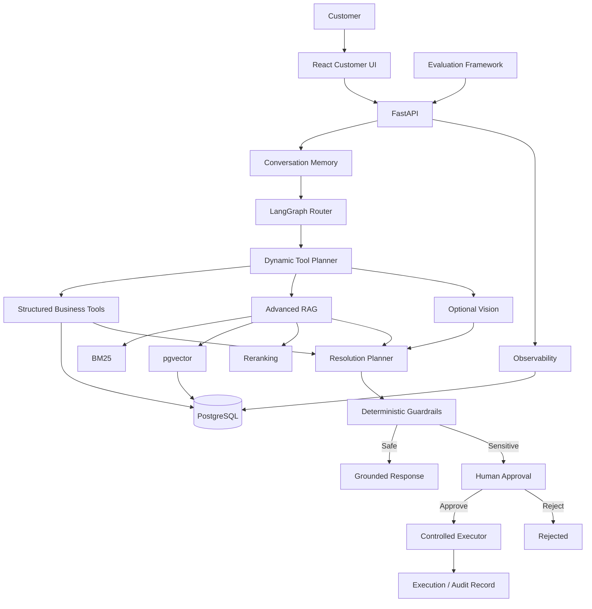
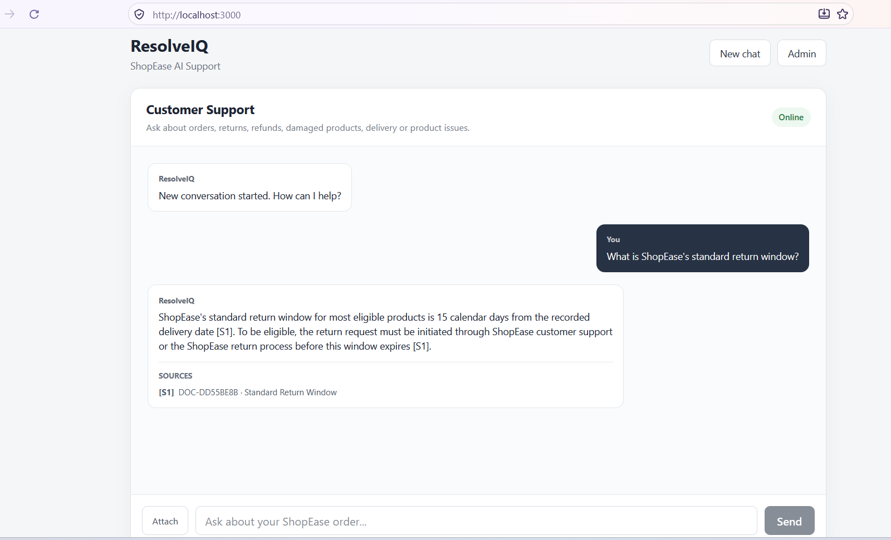
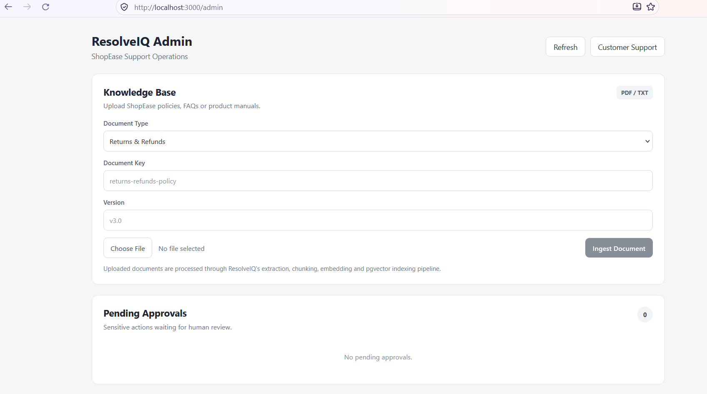

# ResolveIQ

**Agentic AI Customer Support Resolution Platform**

ResolveIQ is an end-to-end agentic AI system that investigates ecommerce customer-support issues using structured business data, company knowledge, persistent memory, optional vision analysis, deterministic guardrails, human approval, and controlled business-action execution.

Unlike a basic support chatbot, ResolveIQ can determine what information it needs, retrieve verified business and policy evidence, propose a resolution, request human approval for sensitive actions, and execute approved actions through a controlled workflow.

---

## Key Features

### Agentic Support Orchestration

- LangGraph-based multi-stage agent workflow
- Query routing between business data, knowledge retrieval, or both
- Dynamic tool planning and execution
- Explicit handling for insufficient evidence and clarification

### Structured Business Tools

ResolveIQ can investigate ShopEase data through controlled SQLAlchemy-based tools:

- Customer lookup
- Customer order history
- Order lookup
- Shipment status
- Return status
- Support tickets

The LLM never receives arbitrary SQL access.

### Advanced RAG

Company policies and manuals are processed through an automated ingestion pipeline:

```text
PDF / TXT
    ↓
Text Extraction
    ↓
Section-Aware Chunking
    ↓
Nomic Embeddings
    ↓
PostgreSQL + pgvector
    ↓
Hybrid Retrieval
```

Retrieval includes:

- Dense vector search
- BM25 lexical retrieval
- Reciprocal Rank Fusion
- Query rewriting
- Intent-aware metadata filtering
- Multi-query retrieval
- Reranking
- Evidence sufficiency assessment
- Grounded citations

### Persistent Memory

ResolveIQ stores:

- Conversations
- Messages
- Customer history
- Previous orders
- Returns
- Support tickets

Follow-up questions can reuse verified conversation context without requiring the customer to repeat identifiers.

### Vision Support

Customers can optionally upload product images for issues such as:

- Damaged items
- Wrong products
- Package damage
- Screen/error evidence

Vision observations are treated as supporting evidence and do not override verified database identity or policy rules.

### Resolution Planning

The agent can propose actions including:

- Provide information
- Request more information
- Create return request
- Create replacement request
- Issue refund
- Issue store credit
- Cancel order
- Escalate to a human

### Deterministic Guardrails

Business actions are validated by deterministic Python guardrails rather than relying entirely on the LLM.

The guardrails verify:

- Required business evidence
- Order references
- Policy sufficiency
- Missing information
- Sensitive-action requirements

### Human-in-the-Loop Approval

Sensitive actions such as:

- Replacements
- Refunds
- Store credit
- Order cancellation

require human approval before execution.

```text
AI Proposal
    ↓
Deterministic Guardrails
    ↓
Pending Human Approval
    ↓
Approve / Reject
    ↓
Controlled Execution
```

### Controlled Execution

Approved business actions are executed through an allowlisted execution layer.

The portfolio implementation safely simulates external ecommerce operations such as refunds and replacement fulfillment.

Execution includes:

- Approval validation
- Idempotency protection
- Persistent execution records
- Success/failure tracking
- Result references
- Audit history

### Observability

Every observed agent run can record:

- Route
- Selected tools
- Knowledge sufficiency
- Resolution action
- Guardrail decision
- Citations
- Latency
- Errors
- Final-answer preview

### Evaluation

ResolveIQ includes a deterministic evaluation framework with a fixed ShopEase benchmark.

| Metric | Result |
|---|---:|
| Benchmark Cases | 8 |
| Overall Pass Rate | **100%** |
| Route Accuracy | **100%** |
| Required Tool Selection Accuracy | **100%** |
| Knowledge Sufficiency Accuracy | **100%** |
| Resolution Accuracy | **100%** |
| Guardrail Accuracy | **100%** |
| Citation Compliance | **100%** |
| Error-Free Rate | **100%** |
| Average Latency | **9.23 s** |
| Median Latency | **7.46 s** |

These results are measured on the fixed 8-case ShopEase benchmark and are not intended as universal production-accuracy claims.

See [Evaluation Report](docs/evaluation-report.md).

---

## Architecture



---

## Technology Stack

### AI / Agent

- Python
- LangGraph
- Ollama
- Native LLM text contracts
- Nomic embeddings
- Vision-language model integration

### Retrieval

- PostgreSQL
- pgvector
- BM25
- Reciprocal Rank Fusion
- Multi-query retrieval
- Reranking

### Backend

- FastAPI
- SQLAlchemy 2
- Alembic
- Pydantic
- PostgreSQL
- psycopg

### Frontend

- React
- TypeScript
- Vite
- React Router

### Deployment

- Docker
- Docker Compose
- Nginx

---

## Knowledge Ingestion

Admins can upload PDF or TXT knowledge documents from the ResolveIQ Admin UI.

The complete ingestion workflow runs automatically:

```text
Upload
  ↓
Text Extraction
  ↓
Section-Aware Chunking
  ↓
Embedding Generation
  ↓
pgvector Indexing
  ↓
Available to RAG
```

Documents support version metadata and active-document retrieval.

---

## Customer Interface

The customer interface supports:

- Persistent conversations
- Order and support questions
- Grounded policy answers
- Citations
- Image attachments
- Conversation restoration after browser reload
- New-chat creation



---

## Admin Interface

The single-page admin dashboard provides:

- Knowledge-document ingestion
- Human approval queue
- Approve & Execute
- Rejection
- Recent agent-run observability
- Routes
- Tool selections
- Resolution decisions
- Guardrail statuses
- Latency



---

## Project Structure

```text
ResolveIQ/
├── backend/
│   ├── alembic/
│   └── app/
│       ├── agent/
│       ├── api/
│       ├── core/
│       ├── db/
│       ├── evaluation/
│       ├── models/
│       ├── repositories/
│       ├── schemas/
│       └── services/
│
├── frontend/
│   └── src/
│       ├── api/
│       ├── components/
│       ├── pages/
│       └── types/
│
├── docs/
├── docker-compose.yml
└── README.md
```

---

## Local Development

### Backend

```bash
cd backend
python -m venv .venv
```

Activate the environment and install dependencies:

```bash
pip install -r requirements.txt
```

Copy:

```text
.env.example
```

to:

```text
.env
```

and configure PostgreSQL and Ollama.

Run migrations:

```bash
alembic upgrade head
```

Start FastAPI:

```bash
uvicorn app.main:app --reload
```

Backend:

```text
http://localhost:8000
```

Swagger:

```text
http://localhost:8000/docs
```

### Frontend

```bash
cd frontend
npm install
npm run dev
```

Frontend:

```text
http://localhost:5173
```

---

## Docker

Build:

```bash
docker compose build
```

Start:

```bash
docker compose up -d
```

Open:

```text
Customer UI:
http://localhost:3000

Admin UI:
http://localhost:3000/admin
```

Stop:

```bash
docker compose down
```

PostgreSQL data is persisted through a Docker volume.

---

## Environment Configuration

Do not commit real `.env` files.

Use the provided `.env.example` files and configure:

- PostgreSQL connection
- Ollama endpoint
- Model configuration
- Any required application settings

The public configuration should use environment-specific values rather than personal LAN addresses.

---

## Safety Design

ResolveIQ intentionally separates AI reasoning from business authorization.

```text
LLM proposes
     ↓
Python validates
     ↓
Human authorizes sensitive actions
     ↓
Controlled executor performs the action
     ↓
Audit record persists
```

Key safeguards include:

- No arbitrary LLM-generated SQL
- Policy-grounded resolution decisions
- Evidence sufficiency checks
- Human approval for sensitive operations
- Idempotent execution
- Restricted business-action allowlists
- Escalation when evidence is insufficient

---

## Limitations

ResolveIQ is a portfolio demonstration using a fictional ecommerce company, ShopEase.

- Refund and fulfillment operations are simulated.
- No real payment gateway or warehouse system is connected.
- Admin authentication is not implemented.
- Vision inference speed depends on available hardware.
- Benchmark results apply only to the included fixed evaluation dataset.

---

## Future Improvements

- Real commerce/payment integrations
- Role-based admin authentication
- Distributed tracing
- Larger evaluation suites
- Automated regression evaluation
- Production monitoring
- Streaming responses
- Additional policy domains

---

## Why I Built ResolveIQ

The project was designed to explore how production-style agentic AI systems can move beyond simple question answering by combining:

- LLM reasoning
- structured tools
- advanced RAG
- persistent memory
- vision
- deterministic safety controls
- human oversight
- controlled execution
- evaluation
- observability

The goal was to build a complete AI workflow rather than only a chatbot interface.